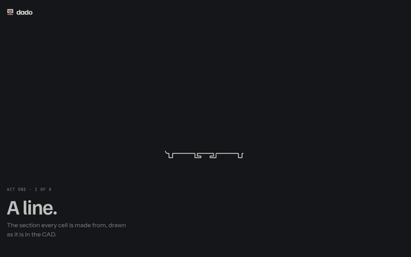
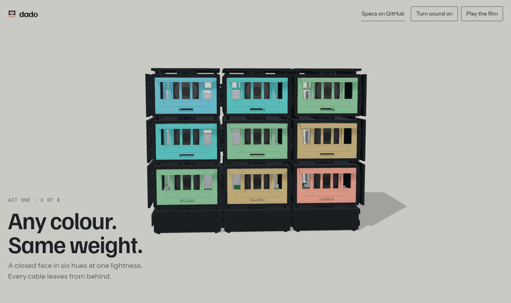
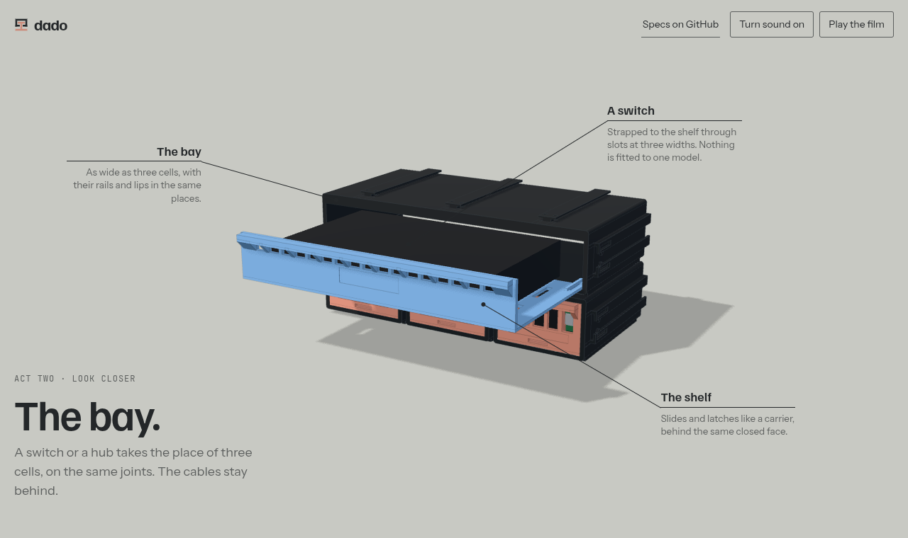
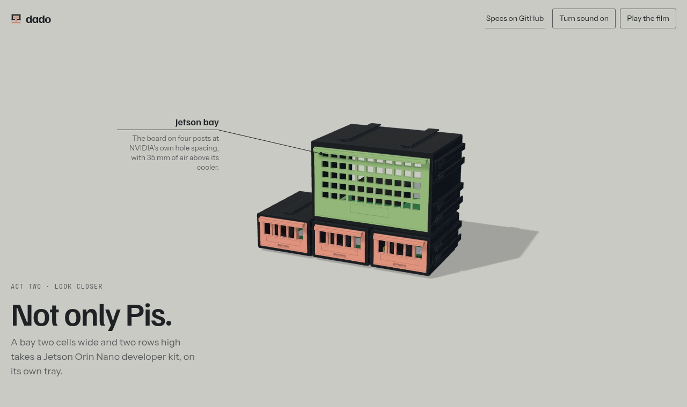
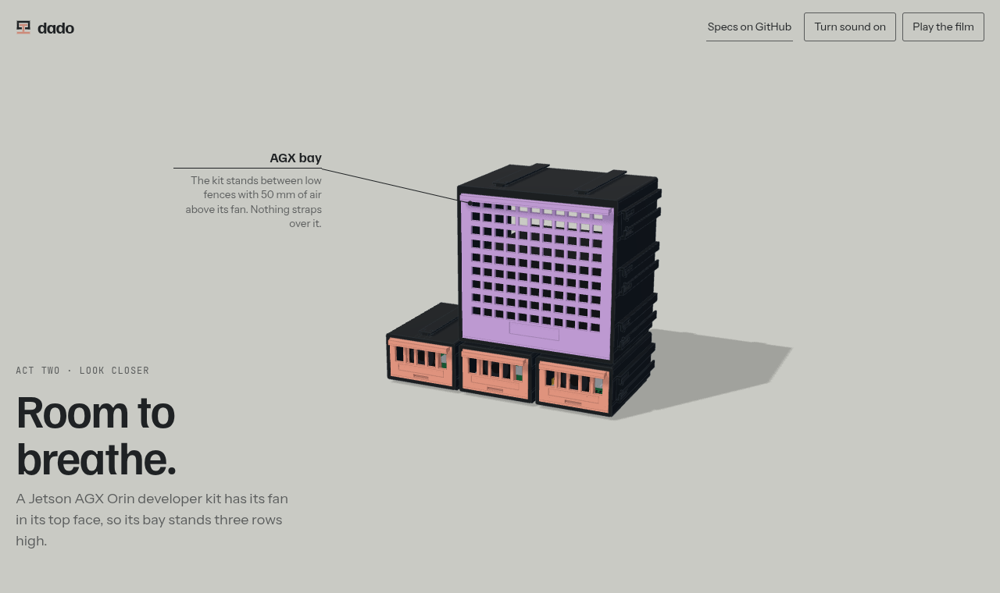
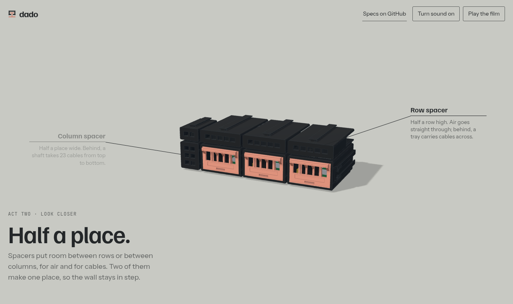

# Dado

**One computer in one cell. Slide a second on and it holds. Keep going.**

Dado is an open-hardware enclosure for Raspberry Pi 5 clusters. Each Pi lives in its own cell, and cells join to each other on four sides by sliding along one axis, so a cluster starts at one and grows to whatever size you need. This repository holds the complete specification: the STEP files, every dimension, the scripts that generated them and the reports of the checks they passed.

**See it move:** [copyleftdev.github.io/dado](https://copyleftdev.github.io/dado/) is a short film built from these exact parts, ending in a configurator.

> **Status: a design, not yet a product.** Every part here has been modelled and checked by calculation and simulation. **Nothing has been printed.** Treat the files as a well-tested starting point, and read [what has not been checked](#what-has-not-been-checked) before you spend money on a print.

## The parts

| Part | What it does | Size, mm | File |
|---|---|---|---|
| Cell | The sleeve. Joins to its neighbours on four sides | 67 × 42 × 100 | [`cell.step`](hardware/step/cell.step) |
| Carrier | Holds the Pi, its fan and its face; slides into a cell and latches | 60.5 × 35.5 × 97 | [`carrier.step`](hardware/step/carrier.step) |
| Base | Stands under each column | 67 × 22 × 100 | [`base.step`](hardware/step/base.step) |
| Caps | Finish the top and both sides of a wall | 2 thick | [`trimtop`](hardware/step/trimtop.step), [`trimrail`](hardware/step/trimrail.step), [`trimlip`](hardware/step/trimlip.step) |
| Bay | The place of three cells, for a switch or a hub | 208.2 × 42 × 100 | [`bay.step`](hardware/step/bay.step), [`shelf.step`](hardware/step/shelf.step) |
| Tall bay | Three wide, two high, for taller gear | 208.2 × 87.6 × 100 | [`baytall.step`](hardware/step/baytall.step), [`shelftall.step`](hardware/step/shelftall.step) |
| Rack bay | Four wide, two high, for ten-inch rack gear one unit tall | 278.8 × 87.6 × 100 | [`bayrack.step`](hardware/step/bayrack.step), [`shelfrack.step`](hardware/step/shelfrack.step) |
| Jetson bay | Two wide, two high, for an NVIDIA Jetson Orin Nano developer kit on its own tray | 137.6 × 87.6 × 100 | [`bayduo.step`](hardware/step/bayduo.step), [`orin.step`](hardware/step/orin.step) |
| AGX bay | Two wide, three high, for an NVIDIA Jetson AGX Orin developer kit, whose fan is in its top face | 137.6 × 133.2 × 100 | [`bayagx.step`](hardware/step/bayagx.step), [`agx.step`](hardware/step/agx.step) |
| Row spacer | Half a row of room between two rows: air through it, a cable tray behind | 67 × 19.2 × 100 | [`spacerrow.step`](hardware/step/spacerrow.step) |
| Column spacer | Half a place of room between two columns: air through it, a cable shaft behind | 31.7 × 42 × 100 | [`spacercol.step`](hardware/step/spacercol.step) |
| Cross | Where a line of row spacers meets a column of spacers | 31.7 × 19.2 × 60 | [`spacercross.step`](hardware/step/spacercross.step) |
| Half base and half top cap | Under and over a column of spacers | 31.7 wide | [`basehalf.step`](hardware/step/basehalf.step), [`trimtophalf.step`](hardware/step/trimtophalf.step) |

Cells sit 70.6 mm apart across and 45.6 mm apart up. Each part can be turned over, cut open and read on the site's [Every part](https://copyleftdev.github.io/dado/parts.html) page. Every dimension of every part, with a sentence saying why it is what it is, is in [`hardware/parameters`](hardware/parameters). The reasoning behind the design is in [SPEC.md](SPEC.md).

## How it works

- **One sliding axis.** Everything that joins moves front to back: cell onto cell, carrier into cell, cap onto wall.
- **One joint.** A T-shaped rail on the top and one side of every cell; a pair of lips on the bottom and the other side. A sprung tooth in the lips drops into a notch in the rail when a cell is home.
- **Cables leave from behind.** The Pi sits with its ports through the carrier's back wall. With power over Ethernet, that is one cable a cell. The front is a closed, coloured door.
- **Air goes straight through.** A 25 mm fan behind the face draws air in through five slots; it leaves through five more above the ports.
- **Peripherals take whole places.** A bay is the cell's own section, stretched, with rails and lips wherever the cells it replaces would have had them.

## Using the files

The STEP files are ready to send to a print bureau or open in any CAD program.

- **Process and material:** designed for powder-bed nylon (PA12, by MJF or SLS). The joints assume parts within ±0.30 mm.
- **What else a cell needs:** a Raspberry Pi 5, four M2.5 screws, and optionally the Active Cooler, a PoE HAT, and a 25 × 25 × 6 mm fan. A standard 10 mm thick fan does not fit under a HAT.
- **Start small.** Print three cells, three carriers, a base and a set of caps first. That is enough to test every joint.

## What has been checked

Each part was built from a script that states its volume by hand; the CAD kernel had to agree within 0.05 % before the part was accepted. After that, each part went through a QC script. The reports are in [`hardware/reports`](hardware/reports).

- Every mesh is closed and matches the kernel's volume.
- Joints seat without touching and hold when pulled, in every position a part can take in a wall.
- A carrier goes in, stops on its face, latches behind the cell, and is held down.
- Raspberry Pi's own model of the Pi 5 sits on the carrier's posts with every port through its window and nothing touching. The tightest port clears by 0.61 mm.
- Joints and latches were simulated across 200,000 parts at printing tolerance.
- Roofs of the bays were calculated for the load of the rows above them.
- The site's configurator can only show walls that can be built. Its rules are one file, [`docs/config.js`](docs/config.js), and [`tools/config.test.mjs`](tools/config.test.mjs) walks all 196 walls they allow and every move between them.
- Two spacers and their gaps are exactly one place, across and up. A stack of column spacers leaves a clear shaft for 23 network cables, a line of row spacers a clear tray for 12, and a straight line through every air slot is unblocked.
- The Jetson tray's posts sit under the four mounting holes in NVIDIA's own drill file, with 1.7 mm spare under the board and at least 34.9 mm above its cooler.
- The AGX tray holds a box of the kit's published size between its fences and stops with 0.5 mm of slack, and the bay leaves 50.7 mm above the fan in its top face.

## What has not been checked

- **Nothing has been printed.** Fit, feel and strength are all predictions.
- **Cooling is unproven.** An earlier thermal model found the Active Cooler alone inadequate under sustained load; the 25 mm intake fan was added since and its effect is not modelled.
- **The fan's power is undecided.** Its lead has a clear path, but where it takes 5 V from is not settled.
- **A PoE HAT's height is unverified.** There is 13.6 mm above the board's tallest part to the cell's roof.
- **The single-height bay carries one row of cells above it,** not three. The tall bay carries three.
- **The Jetson bay was checked against NVIDIA's published sizes, not a model of the board.** Its cooling is not modelled (the board can draw about 25 W), and it takes 9 to 20 V at a barrel socket, not the Pis' 5 V.
- **The AGX bay was checked against a plain box of NVIDIA's three outside sizes.** The kit's feet and underside are not in the drawing used, and the tray's latch fingers need 1.2 mm of room under the kit to release. Its cooling is not modelled (15 to 60 W), and it stands 18.5 mm out behind the bay.
- **Row spacers and crosses have no side joint.** They are too low to carry it, so they are held from above and below only. There is no side cap half a row high.
- **A bay over column spacers is held only by the cells under it,** so the configurator puts columns of spacers between bays, never under one.
- **Wire management is a route, not a fit.** Spacers give cables a tray and a shaft behind the wall; how tightly a lead bends from a port into them is not modelled, and neither is the air through their slots.
- **Tall walls need a deeper base** than the desk-scale one here.

## Projections

Calculated from the part volumes and published figures; none is measured. The full table, the inputs and their sources are in [`projections`](projections).

| Configuration | Pis | Size, mm | Loaded | Typical power | Print cost |
|---|---|---|---|---|---|
| One | 1 | 78 × 74 × 110 | 0.3 kg | 6 W | $53 to $101 |
| Trio | 3 | 219 × 74 × 110 | 0.9 kg | 19 W | $148 to $280 |
| Four and a Jetson | 4 | 149 × 211 × 110 | 1.5 kg | 40 W | $234 to $442 |
| Four and an AGX Orin | 4 | 149 × 257 × 127 | 2.2 kg | 55 W | $253 to $479 |
| Six and a bay | 6 | 219 × 165 × 110 | 1.8 kg | 37 W | $317 to $600 |
| Nine | 9 | 219 × 165 × 110 | 2.1 kg | 56 W | $309 to $583 |
| Nine, spaced | 9 | 290 × 211 × 110 | 2.9 kg | 56 W | $518 to $980 |
| Twenty-four and two bays | 24 | 431 × 257 × 110 | 6.0 kg | 149 W | $925 to $1,748 |
| A hundred | 100 | 714 × 485 × 110 | 21.0 kg | 620 W | $2,757 to $5,214 |

Print cost is for the printed parts only, at bureau prices for PA12 collected in November 2026. It excludes the Pis and everything electrical.

## Where this is going

In order, and each depends on the one before:

1. **Print three cells and measure them.** Every tolerance, the latch forces and the feel of the pull are waiting on this.
2. **Measure heat** in a cell under sustained load, with and without the fan, alone and surrounded.
3. **Settle the fan's power** and publish a wiring note.
4. **Finish the cabling:** revive the spine, or route patch leads down the back.
5. **A base for tall walls,** and a stiffer single-height bay.
6. **A moulding study,** once the printed design has stopped changing.

There are no dates on this list. It moves when a step is actually done.

## Rebuilding from source

The scripts in [`hardware/source`](hardware/source) generated every part. They drive Ringwright, a parametric CAD engine that is not yet public, so today they are a readable record of the design, not something you can run. The STEP files and parameters are the usable specification. See [`hardware/source/README.md`](hardware/source/README.md).

## Licences

| What | Licence |
|---|---|
| Hardware: STEP files, parameters, and the scripts as design documentation | [CERN-OHL-S-2.0](LICENSES/CERN-OHL-S-2.0.txt) |
| Software: scripts in `hardware/source`, `projections`, `tools`, and the site's own code | [GPL-3.0-or-later](LICENSES/GPL-3.0-or-later.txt) |
| Documentation, reports, images and the site's text | [CC-BY-SA-4.0](LICENSES/CC-BY-SA-4.0.txt) |

All three are reciprocal: you may use, change, make and sell, and what you distribute must stay open under the same terms. Details, and the third-party material that is not ours to license, are in [LICENSE.md](LICENSE.md) and [NOTICE.md](NOTICE.md).

## The name

A dado is the groove cut across a board so another piece slides in and stays. The name has not been checked against trade marks.
